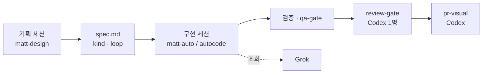

# 목적별 loop — 기획 세션과 구현 세션, 쓰는 손은 main 하나

- 날짜: 2026-11-26
- 근거: `reports/단일 세션 중심 에이전트 흐름 검증.md`
- 그림: `reports/purpose-loops-design.html`

## 큰 틀

weed-harness의 loop는 구현과 수정을 매번 새 워커에게 넘긴다. matt-auto core 모드도 티켓 하나를 새 컨텍스트 워커에게 맡기고, 리뷰 수정도 새 워커가 한다. 조사 결과 순차적인 코딩 작업에서는 한 세션이 맥락을 들고 직접 쓰는 쪽이 토큰과 품질 모두에서 유리했고, subagent가 이기는 자리는 맥락이 필요 없는 조회, 서로 독립인 병렬 작업, 작성 과정을 보지 않은 리뷰뿐이었다.

이 설계는 loop를 목적 세 가지로 정리하고, 각 loop를 두 개의 main 세션으로 나눈다.

| 목적 | 기획 세션 | 구현 세션 |
|---|---|---|
| 기능 개발 | `matt-design` → `kind: feature` spec | `matt-auto --spec` |
| 성능·Rust | `matt-design` + `rust-rewrite` 1–3단계 → `kind: optimize` spec | `autocode init --spec` → `run` |
| 자동 연구 (autoresearch 방식) | `matt-design` → `kind: research` spec | `autocode init --spec` → `run` |

두 세션 사이의 인계물은 spec 파일 하나다. 구현 세션은 spec 경로만 받고 새 세션으로 시작한다.

subagent는 네 자리에서만 쓴다.

| 자리 | 누가 | 조건 |
|---|---|---|
| 조회 | Grok (예산 초과·미설치 시 호스트의 조회 경로) | 결과만 필요하고 과정은 main 맥락에 필요 없는 탐색 |
| 독립 병렬 작업 | 호스트 워커 | 따로 검증되는 산출물이 둘 이상 (full 모드 티켓, autocode 가설) |
| 리뷰 | Codex 1명 (Codex가 쓴 코드는 Claude) | 읽기 전용, 코멘트만, 수정은 작성한 main |
| 최종 시각 보고 | Codex | `pr-visual`의 As-Is / To-Be 촬영과 그림 |

## 목표

1. matt-auto core에서 main 세션이 직접 구현하고 리뷰 발견도 직접 고친다. 검증 재실행, qa-gate, review-gate, HEAD에 묶인 판정은 그대로다.
2. review-gate는 교차 계열 리뷰어 1명으로 돈다. Claude·Grok이 쓴 코드는 Codex, Codex가 쓴 코드는 Claude가 본다. 두 계열이 함께 쓴 코드(`mixed`/`unknown`)는 독립인 계열이 없으므로 계열별 1명씩 본다. Grok은 리뷰에서 빠진다.
3. `gate-route.mjs --role lookup`이 조회 경로를 정한다. Grok 주간 사용량이 90% 미만이면 Grok, 아니면 호스트의 조회 경로.
4. `pr-visual`의 촬영과 그림은 Codex가 만든다. main은 결과 파일을 받아 보여 주고 PR 본문에 넣는다.
5. spec의 `kind`가 `feature` / `optimize` / `research` 세 목적을 나타내고, `rust-port`는 `rust-rewrite`로 이름을 바꿔 성능 loop의 규칙집이 된다.

## 비목표

- matt-auto full 모드의 분할 규칙(규칙 3 `[deep]`, 규칙 6 외부 인터페이스)은 바꾸지 않는다. core 전환을 실측한 뒤 다시 본다.
- autocode의 strategist와 병렬 experimenter 구조는 바꾸지 않는다.
- `hc-workers`의 구조, `qa-gate`, `loop-gates`는 바꾸지 않는다.
- Paseo를 리뷰어 기본 실행 경로로 삼지 않는다.

## 확정 구조

## 결정

| ID | 질문 | 선택 | 근거 |
|---|---|---|---|
| D1 | "auto research"의 뜻 | Karpathy의 autoresearch 방식. 별도 스킬 없이 `autocode` | 사용자 확정 |
| D2 | 리뷰어 | Codex 고정. Grok은 리뷰에서 제거 | 사용자 확정 |
| D3 | 리뷰어 실행 경로 | `codex exec -s read-only --output-schema` 유지. Paseo는 선택 실행 줄 | 제안 채택 (사용자 위임) |
| D4 | 구현 세션 모델 | 기획은 Fable, 구현은 Opus로 시작. 실측 후 확정 | 제안 채택 |
| D5 | autocode strategist | 지속형 subagent 유지 | 제안 채택 |
| D6 | 세션 인계 | spec 경로를 들고 새 세션을 직접 시작 | 제안 채택 |
| D7 | Codex가 쓴 코드의 리뷰어 | Claude | 제안 채택 |
| D8 | Grok 조회 범위 | 코드 조회와 웹 검색 모두. 측정: 2026-11-26 코드+웹 조회 1건 17초, $0.07 (`grok-4.7-build-fast`) | 제안 채택 |
| D9 | Rust 스킬 이름 | `rust-rewrite` | 사용자 확정 |
| D10 | As-Is / To-Be 최종 보고 | Codex 전담 | 사용자 확정 |

## 수용 기준

1. `npm test`가 통과한다 (`check-words`, routing·gate 테스트 포함).
2. `gate-route.mjs --role review --writer claude --available claude,codex,grok`가 Codex 리뷰어 1명만 낸다.
3. `gate-route.mjs --role review --writer codex --available claude,codex,grok`가 Claude 리뷰어 1명만 낸다.
4. 작성자가 한 계열일 때 위험 트리거(`--deep`, 보안 경로)가 붙으면 같은 리뷰어 1명이 `review_up` 티어로 오르고, 두 번째 리뷰어는 붙지 않는다.
5. `gate-route.mjs --role lookup --host claude`가 Grok 예산 안이면 Grok, 아니면 Claude의 조회 경로를 낸다.
6. matt-auto core 문서에 구현·수정 워커가 없고, execution-core의 "fixes go to a fresh worker" 규칙은 full 모드로 한정된다. 두 에디션의 execution-core는 바이트 동일하다.
7. `skills/rust-port`가 `skills/rust-rewrite`로 바뀌고 저장소 안에 `rust-port` 참조가 남지 않는다 (`docs/design`의 과거 기록 제외).

## 구현 순서

1. [default] `gate-routes.json`, `gate-route.mjs`, 테스트: 리뷰 1명 규칙, lookup 역할. 확인: `node --test skills/model-routing/tests/`.
2. [default] `grok-priority.md`, `model-routing/SKILL.md`: 리뷰 슬롯 제거, 조회 슬롯과 실행 줄 추가. 확인: `node bin/check-words.mjs`.
3. [default] `review-gate`: 리뷰어 1명, Grok 실행 줄 제거, minor 처리, Paseo 선택 줄.
4. [default] matt-auto core-mode(두 에디션), execution-core(두 에디션), SKILL.md 엔진 문구. 확인: `node bin/check-words.mjs`.
5. [default] `pr-visual`: Codex 실행. `matt-design` spec 계약: `kind` 세 값, 세션 인계. autocode의 `--spec` 안내.
6. [default] `rust-port` → `rust-rewrite` 이름 변경과 loop 배치 절, 참조 갱신.
7. [default] `CLAUDE.md`: 병렬 규칙 한정, 리뷰 후 수정 규칙을 blocker/major로, 없는 훅 문장 삭제.
8. 전체 확인: `npm test`, Codex 리뷰 1회.

## 검토 로그

- 2026-11-25 조사 보고서: 단일 세션 우위는 순차 코딩에서 성립, 리뷰 1회는 결정적 검사와 함께여야 함.
- 2026-11-25 사용자: 목적 세 가지, 기획/구현 main 분리, subagent는 필요한 곳만.
- 2026-11-26 사용자: D1 autoresearch, D2 Codex 고정, D9 이름, D10 Codex 시각 보고, 조회는 Grok 최대 활용, 나머지 미결은 제안대로.

## 확인

2026-11-26 사용자가 "성능적인 것은 추천대로, 미결도 추천대로 계획을 마무리하고 수정 및 테스트 진행"으로 revision 1을 확정.
